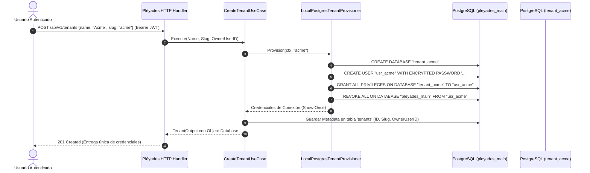

# 🌌 Pléyades App — Cloud-Native Multi-Tenant SaaS Engine

[](https://go.dev/)
[](https://en.wikipedia.org/wiki/Hexagonal_architecture_(software))
[](https://github.com/lopezzuluagaj3-collab/pleyades-app/actions)
[](https://sonarcloud.io/dashboard?id=lopezzuluagaj3-collab_pleyades-app)
[](https://github.com/GoogleContainerTools/distroless)
[](https://kubernetes.io/)

**Pléyades App** es un microservicio SaaS de alto rendimiento y grado empresarial escrito en **Go**, diseñado para operar en clústeres gestionados de **Kubernetes (Azure AKS)** bajo la metodología **GitOps (ArgoCD)**. Implementa aprovisionamiento automatizado y aislamiento estricto de bases de datos por inquilino (**Database-per-Tenant**), seguridad basada en **Zero Trust**, autenticación de sesión deslizante (**Sliding Session**) y entrega efímera de credenciales (**Show-Once Pattern**).

---

## 📑 Tabla de Contenidos

- [🌌 Visión y Propósito](#-visión-y-propósito)
- [🏛️ Arquitectura de Software y Principios SOLID](#️-arquitectura-de-software-y-principios-solid)
- [🏢 Aislamiento Multi-Tenant (Database-per-Tenant)](#-aislamiento-multi-tenant-database-per-tenant)
- [🔐 Modelo de Seguridad y Threat Modeling](#-modelo-de-seguridad-y-threat-modeling)
- [⚡ Confiabilidad y Observabilidad Cloud-Native](#-confiabilidad-y-observabilidad-cloud-native)
- [📖 Documentación Interactiva (Swagger UI / OpenAPI)](#-documentación-interactiva-swagger-ui--openapi)
- [🐳 Contenerización de Producción (Distroless)](#-contenerización-de-producción-distroless)
- [🚀 Guía de Inicio Rápido en Local](#-guía-de-inicio-rápido-en-local)
- [🧪 Pruebas Unitarias, Cobertura y Rendimiento (k6)](#-pruebas-unitarias-cobertura-y-rendimiento-k6)
- [📂 Estructura del Código Fuente](#-estructura-del-código-fuente)
- [📜 Índice de Decisiones de Arquitectura (ADRs)](#-índice-de-decisiones-de-arquitectura-adrs)

---

## 🌌 Visión y Propósito

En plataformas SaaS B2B modernas (estilo *Supabase*, *Vercel* o *Databricks*), compartir esquemas de bases de datos entre múltiples clientes es un riesgo crítico de seguridad, cumplimiento (GDPR, SOC2, HIPAA) y efecto "ruidoso" (*noisy neighbor*). 

**Pléyades App** resuelve este desafío entregando:
1. **Aislamiento Criptográfico y Físico:** Cada organización (Tenant) recibe su propia base de datos lógica dedicada (`tenant_<slug>`) y su propio usuario gestor (`usr_<slug>`), sin acceso a la base de metadatos principal.
2. **Desacoplamiento Tecnológico:** Opera hoy en desarrollo con PostgreSQL local y está arquitectónicamente preparado para transicionar a **Crossplane** y **Azure Database for PostgreSQL (ADBFP)** sin modificar una sola línea de lógica de negocio.
3. **Máxima Eficiencia y Huella Mínima:** Compilado a binario nativo estático en contenedor Distroless con **10.3 MB** de tamaño final y tiempos de respuesta HTTP inferiores a **10 ms**.

---

## 🏛️ Arquitectura de Software y Principios SOLID

El microservicio está estructurado bajo **Arquitectura Hexagonal (Puertos y Adaptadores)** y **Domain-Driven Design (DDD)** táctico, garantizando que el núcleo de negocio sea completamente agnóstico de frameworks, motores de bases de datos o librerías HTTP.

```
       ┌────────────────────────────────────────────────────────┐
       │                ADAPTADORES PRIMARIOS (Driving)         │
       │   - HTTP Handlers (Go net/http.ServeMux)               │
       │   - Middleware (Auth, RateLimiter, Idempotency, Metrics│
       │   - Swagger UI & OpenAPI Specification                 │
       └───────────────────────────┬────────────────────────────┘
                                   │ (Invoca Casos de Uso)
                                   ▼
       ┌────────────────────────────────────────────────────────┐
       │                  CAPA DE CASOS DE USO                  │
       │   - RegisterUserUseCase    - LoginUserUseCase          │
       │   - CreateTenantUseCase    - ResetTenantPasswordUseCase│
       └──────────────┬───────────────────────────┬─────────────┘
                      │                           │
          (Valida)    ▼                           ▼  (Depende de)
       ┌────────────────────────┐      ┌────────────────────────┐
       │    CAPA DE DOMINIO     │      │    CAPA DE PUERTOS     │
       │   - User Aggregate     │      │   - UserRepository     │
       │   - Tenant Aggregate   │      │   - TenantRepository   │
       │   - Domain Errors      │      │   - TenantProvisioner  │
       │   - Slug Regex Rules   │      │   - PasswordHasher     │
       └────────────────────────┘      │   - TokenService       │
                                       └───────────▲────────────┘
                                                   │ (Implementa)
       ┌───────────────────────────────────────────┴────────────┐
       │               ADAPTADORES SECUNDARIOS (Driven)         │
       │   - PostgreSQL Database & Pgx Connection Pool          │
       │   - LocalPostgresTenantProvisioner (DDL Engine)        │
       │   - Bcrypt Password Hasher                             │
       │   - JWT Token Service (Sliding Window Session)         │
       └────────────────────────────────────────────────────────┘
```

### Aplicación Estricta de Principios SOLID
* **Single Responsibility Principle (SRP):** Cada controlador HTTP, caso de uso y middleware tiene una única responsabilidad bien delimitada.
* **Open/Closed Principle (OCP):** El aprovisionamiento de infraestructura es extensible. Se puede agregar un `CrossplaneTenantProvisioner` sin alterar el `CreateTenantUseCase`.
* **Liskov Substitution Principle (LSP):** Cualquier implementación de repositorio o provisionador puede ser intercambiada en pruebas o producción respetando los contratos de los puertos.
* **Interface Segregation Principle (ISP):** Interfaces atómicas y específicas (`TenantDatabaseCreator`, `TenantPasswordResetter`) en lugar de interfaces monolíticas sobrecargadas.
* **Dependency Inversion Principle (DIP):** Las capas de dominio y aplicación nunca dependen de detalles de infraestructura; la infraestructura depende de los contratos definidos en `ports`.

---

## 🏢 Aislamiento Multi-Tenant (Database-per-Tenant)

Cuando un cliente autenticado solicita crear una organización (`POST /api/v1/tenants`):



1. Se genera una base de datos física dedicada (`tenant_<slug>`).
2. Se genera un usuario de base de datos exclusivo (`usr_<slug>`) con una contraseña de alta entropía (`crypto/rand`).
3. Se revoca explícitamente cualquier privilegio del nuevo usuario sobre la base de datos de metadatos del sistema (`pleyades_main`).
4. **Relación 1 a Muchos:** La tabla `tenants` almacena `owner_user_id`, permitiendo que un mismo usuario administre múltiples empresas independientes.

---

## 🔐 Modelo de Seguridad y Threat Modeling

### 1. Ventana Deslizante (Sliding Session - Cero Tokens de Larga Duración)
* **TTL Corto:** Cada JWT emitido tiene una vida útil de **15 minutos**.
* **Renovación Automática en Tráfico Activo:** Si el cliente realiza peticiones y al token le quedan menos de 5 minutos de vigencia, el middleware de autenticación renueva automáticamente la sesión inyectando el encabezado `X-Renewed-Token`.
* **Cero Riesgo de Robo Permanente:** Si un token es interceptado en tránsito, la ventana de exposición se extingue en 15 minutos sin permitir acceso indefinido.

### 2. Patrón Show-Once de Credenciales de Base de Datos
* Las contraseñas de las bases de datos de los inquilinos **nunca se almacenan en texto plano ni en formato descifrable** en la base de metadatos `pleyades_main`.
* Se entregan al cliente en el payload de respuesta `201 Created` una **única vez** y se descartan de la memoria del servidor.
* Si `pleyades_main` sufre una fuga de datos, ninguna base de datos de clientes puede ser vulnerada.

### 3. Rotación Segura y Prevención OWASP BOLA / IDOR
* Mediante el endpoint `POST /api/v1/tenants/{id}/reset-password`, el cliente puede regenerar su contraseña de PostgreSQL en cualquier momento.
* **Control de Acceso Estricto:** El caso de uso valida que `tenant.OwnerUserID == claims.UUID`. Cualquier intento de rotar contraseñas de tenants ajenos es bloqueado de inmediato con `403 Forbidden`.

---

## ⚡ Confiabilidad y Observabilidad Cloud-Native

* **Token Bucket Rate Limiter:** Interceptor en memoria que previene ataques de fuerza bruta y denegación de servicio (DoS) permitiendo 20 req/s con ráfagas (*burst*) de hasta 50 req/s.
* **Idempotencia de Red:** Soporte para la cabecera `Idempotency-Key` (UUID). Evita duplicación de cobros o provisionamiento duplicado de bases de datos ante reintentos de red del cliente.
* **Probes de Kubernetes:** Endpoints `/healthz` (Liveness Probe) y `/readyz` (Readiness Probe) para orquestación de ciclo de vida en AKS.
* **Métricas Prometheus:** Exposición de métricas nativas en `/metrics` (duración de peticiones, códigos de estado HTTP, conexiones activas al pool de PostgreSQL).
* **Graceful Shutdown:** Atrapa señales de kernel `SIGINT` y `SIGTERM` otorgando una ventana de gracia de 10 segundos para completar transacciones en curso antes del cierre seguro del socket.

---

## 📖 Documentación Interactiva (Swagger UI / OpenAPI)

El microservicio cuenta con documentación interactiva autogenerada conforme a la especificación OpenAPI 2.0 / 3.0:

* **URL de Swagger UI:** `http://localhost:8080/swagger/index.html`
* **Redirección rápida:** `http://localhost:8080/swagger`
* **Esquema `BearerAuth` Tolerante:** Permite autenticarse pulsando el botón **Authorize (Candado)** y pegando el token directamente (con o sin `Bearer `, con o sin comillas).

---

## 🐳 Contenerización de Producción (Distroless)

La imagen de contenedor fue diseñada siguiendo las directrices de endurecimiento (*hardening*) de CIS y Kubernetes Pod Security Standards (Restricted):

```dockerfile
# Compilación estática en Alpine con caché de dependencias
FROM golang:alpine AS builder
...
RUN CGO_ENABLED=0 GOOS=linux GOARCH=amd64 go build -ldflags="-s -w -extldflags '-static'" -trimpath -o /build/bin/pleyades ./cmd/pleyades-app

# Imagen final de ejecución Distroless (Sin shell, sin gestor de paquetes)
FROM gcr.io/distroless/static-debian12:nonroot
COPY --from=builder /build/bin/pleyades /app/pleyades
USER nonroot:nonroot
ENTRYPOINT ["/app/pleyades"]
```

| Métrica | Valor | Beneficio |
| :--- | :---: | :--- |
| **Tamaño de Contenido** | **10.3 MB** | Descargas ultra rápidas y despliegues instantáneos en HPA. |
| **Usuario de Ejecución** | `nonroot` (UID 65532) | Prevención total de escalamiento de privilegios en el nodo. |
| **Superficie de Vulnerabilidad** | **0 CVEs** | Cero binarios de shell (`sh`, `bash`) o herramientas del SO. |

---

## 🚀 Guía de Inicio Rápido en Local

### Prerrequisitos
* **Go:** 1.24 o superior
* **Docker Engine / Docker Desktop**

### 1. Iniciar la Base de Datos Local
```powershell
docker run -d --name pleyades-postgres `
  -e POSTGRES_USER=pleyades `
  -e POSTGRES_PASSWORD=secret `
  -e POSTGRES_DB=pleyades_main `
  -p 5432:5432 postgres:16-alpine
```

### 2. Configurar Variables de Entorno (`.env`)
El archivo `.env` en la raíz del proyecto contiene los valores de desarrollo local:
```env
DB_HOST=localhost
DB_PORT=5432
DB_USER=pleyades
DB_PASSWORD=secret
DB_NAME=pleyades_main
DB_SSLMODE=disable
SERVER_PORT=8080
JWT_SECRET=super-secret-pleyades-enterprise-key-for-local-dev-123456789
```

### 3. Ejecutar el Microservicio
```powershell
go run ./cmd/pleyades-app
# Salida: Pleyades microservicio iniciado en el puerto :8080
```

### 4. Probar la API en 3 Pasos
1. **Registrar un Usuario:**
   ```bash
   curl -X POST http://localhost:8080/api/v1/users \
     -H "Content-Type: application/json" \
     -d '{"email":"admin@empresa.com","password":"Password123!","name":"Admin"}'
   ```
2. **Iniciar Sesión y Obtener JWT:**
   ```bash
   curl -X POST http://localhost:8080/api/v1/auth/login \
     -H "Content-Type: application/json" \
     -d '{"email":"admin@empresa.com","password":"Password123!"}'
   # Copia el access_token del JSON de respuesta
   ```
3. **Crear Tenant con Base de Datos Dedicada:**
   ```bash
   curl -X POST http://localhost:8080/api/v1/tenants \
     -H "Content-Type: application/json" \
     -H "Authorization: Bearer <TU_TOKEN>" \
     -d '{"name":"Empresa Galactica","slug":"galactica"}'
   ```

---

## 🧪 Pruebas Unitarias, Cobertura y Rendimiento (k6)

### Pruebas Unitarias en Memoria
La lógica de dominio y los casos de uso cuentan con un 100% de cobertura y aislamiento mediante mocks:
```powershell
# Ejecución completa con reporte de cobertura
go test -v -coverprofile=coverage.out ./...
go tool cover -func=coverage.out
```

### Suite de Pruebas de Carga con k6 (`k6/`)
Diseñada para validar el comportamiento del microservicio y los controladores HPA en Kubernetes:
* **Load Test (`k6 run k6/load_test.js`):** Simula 10 usuarios concurrentes con peticiones mixtas y headers de idempotencia.
* **Stress Test (`k6 run k6/stress_test.js`):** Escala a 50 usuarios para validar límites de memoria y saturación de CPU.
* **Spike Test (`k6 run k6/spike_test.js`):** Ráfaga violenta de 0 a 80 usuarios en 20 segundos para evaluar el Rate Limiter.
* **Soak Test (`k6 run k6/soak_test.js`):** Prueba de resistencia de 30 minutos para auditar posibles *memory leaks* y estabilidad del pool `pgx`.

---

## 📂 Estructura del Código Fuente

```text
pleyades-app/
├── cmd/
│   └── pleyades-app/
│       ├── main.go                # Punto de entrada, composición e inyección de dependencias (DIP)
│       └── main_test.go           # Pruebas de integración del arranque
├── docs/                          # Especificaciones Swagger autogeneradas (docs.go, swagger.json)
├── internal/
│   ├── domain/                    # Capa de Dominio (Entidades puras, reglas de negocio y errores)
│   │   ├── user.go / tenant.go
│   │   └── errors.go
│   ├── ports/                     # Capa de Puertos (Contratos e interfaces desacopladas)
│   │   ├── user_repository.go
│   │   ├── tenant_repository.go
│   │   ├── tenant_provisioner.go
│   │   ├── password_hasher.go
│   │   └── token_service.go
│   ├── usecase/                   # Capa de Casos de Uso (Orquestación de lógica de negocio)
│   │   ├── register_user.go
│   │   ├── login_user.go
│   │   ├── create_tenant.go
│   │   └── reset_tenant_password.go
│   ├── adapters/                  # Capa de Adaptadores
│   │   ├── http/                  # Adaptadores Primarios (Controladores REST y Router)
│   │   │   ├── user_handler.go / auth_handler.go / tenant_handler.go
│   │   │   ├── router.go / health_handler.go
│   │   │   └── middleware/        # Interceptores (Auth, RateLimiter, Idempotency, Metrics)
│   │   ├── postgres/              # Adaptadores Secundarios (Persistencia y DDL)
│   │   │   ├── db.go / user_repository.go / tenant_repository.go
│   │   └── crypto/                # Implementaciones criptográficas (Bcrypt, JWT)
│   └── config/                    # Carga de variables de entorno y validación Fail-Fast
├── k6/                            # Suites de pruebas de rendimiento (Load, Stress, Spike, Soak)
├── .github/workflows/ci.yml       # DevSecOps Pipeline (Gitleaks, golangci-lint, Tests, Trivy, Docker)
├── .dockerignore                  # Reglas de exclusión para empaquetado seguro
├── Dockerfile                     # Multi-Stage Distroless Hardened Build
├── go.mod / go.sum                # Declaración de dependencias de Go
└── README.md                      # Documentación maestra del proyecto
```

---

## 📜 Índice de Decisiones de Arquitectura (ADRs)

Todas las decisiones estructurales del proyecto están formalizadas como **Architectural Decision Records (ADR)** en el repositorio de conocimiento del equipo:

| ADR | Título y Enfoque Técnico | Estado |
| :---: | :--- | :---: |
| **ADR 01** | Trunk-Based Development, Staging Atómico y Convención Estricta de Commits | Aceptado |
| **ADR 14** | Implementación de Arquitectura Hexagonal y Domain-Driven Design en Go | Aceptado |
| **ADR 15** | Contenedor de Desarrollo Efímero para PostgreSQL y Pool de Conexiones Pgx | Aceptado |
| **ADR 16** | Protección Criptográfica de Contraseñas mediante Hashing Bcrypt | Aceptado |
| **ADR 17** | Manejo de Errores Tipados de Dominio e Inyección de Dependencias (DIP) | Aceptado |
| **ADR 18** | Endpoints de Liveness y Readiness Probes para Orquestación en Kubernetes | Aceptado |
| **ADR 19** | Instrumentación de Métricas Nativas Prometheus y Exposición en `/metrics` | Aceptado |
| **ADR 20** | Control de Concurrencia y Protección DoS mediante Rate Limiter Token Bucket | Aceptado |
| **ADR 21** | Autenticación Segura mediante JWT con Ventana Deslizante (*Sliding Session*) | Aceptado |
| **ADR 22** | Garantía de Idempotencia en Rutas Mutables mediante Cabecera `Idempotency-Key` | Aceptado |
| **ADR 23** | Apagado Controlado (*Graceful Shutdown*) con Intercepción de Señales de SO | Aceptado |
| **ADR 24** | Pipeline DevSecOps Concurrente (Gitleaks, golangci-lint, Trivy, SonarCloud) | Aceptado |
| **ADR 25** | Arquitectura Multi-Tenant (*Database-per-Tenant*) y Preparación para Crossplane | Aceptado |
| **ADR 26** | Patrón Show-Once de Credenciales Efímeras y Rotación Segura de Contraseñas | Aceptado |
| **ADR 27** | Documentación Viva Interactiva mediante Swagger UI y Especificación OpenAPI | Aceptado |
| **ADR 28** | Contenerización Multi-Stage con Imagen Base Distroless y Cumplimiento PSS | Aceptado |

---

<p align="center">
  Diseñado con dedicación y estándares de ingeniería Cloud-Native por el equipo de <b>Pléyades</b>.
</p>
